# ESP32 Vehicular IoT System

Two ESP32 boards monitor a vehicle cabin.

* The **sensor node** measures temperature/humidity, motion, orientation and shock, and sends
  them over an **encrypted, authenticated ESP-NOW link**.
* The **gateway** adds its own temperature, flame and potentiometer readings, raises local
  alarms, and sends **60-second summaries and prioritised alerts** to **Azure IoT Hub** over
  MQTT/TLS.

> **Status: software baseline.** The firmware builds, and the shared logic passes host unit
> tests and a host integration harness. **It has not yet run on physical boards or against a
> real Azure IoT Hub.** See [Verification status](#verification-status).

## Architecture

```mermaid
flowchart LR
  subgraph SN["Sensor node (ESP32)"]
    direction TB
    subgraph SNHW["Drivers"]
      DHT11["2× DHT11"]
      MPU["MPU6050<br/>IMU task ~100 Hz"]
      SHK["Shock sensor<br/>GPIO interrupt"]
      PIR["PIR"]
    end
    SAPP["SensorApp<br/>tilt alarm · impact events · telemetry"]
    SLINK["SensorLinkCore<br/>channel sweep · session · event retries"]
    SLED["LED / buzzer (optional)"]
    SNHW --> SAPP --> SLINK
    SAPP --> SLED
  end

  subgraph GW["Gateway (ESP32)"]
    direction TB
    GLINK["GatewayLinkCore<br/>verify tag · replay window · dedupe"]
    subgraph GWHW["Drivers"]
      DHT22["DHT22"]
      FL["Flame sensor (ADC)"]
      POT["Potentiometer (ADC)"]
    end
    GAPP["GatewayApp<br/>aggregation · alarms · reminders"]
    OUT["Cloud outbox<br/>16 alert + 2 summary slots"]
    CLOUD["CloudLinkCore<br/>SAS renewal · backoff"]
    MQTT["esp-mqtt + Azure SDK for C<br/>QoS 1"]
    GLED["LED / buzzer (optional)"]
    GLINK --> GAPP
    GWHW --> GAPP
    GAPP --> OUT --> CLOUD --> MQTT
    GAPP --> GLED
  end

  SLINK -- "ESP-NOW unicast<br/>CCMP + HMAC tag<br/>telemetry 500 ms · acked events" --> GLINK
  MQTT -- "MQTT 3.1.1 / TLS<br/>SAS token" --> HUB[("Azure IoT Hub")]
  GW -. "Wi-Fi station" .- AP["Access point"]
```



The `...App` and `...Core` blocks are hardware-independent classes in
[`lib/vehicle_core`](lib/vehicle_core). The firmware and the host tests use them unchanged;
the firmware only adds drivers and small adapters for ESP-NOW, NVS and esp-mqtt.

| | Sensor node | Gateway |
|---|---|---|
| Sensors | 2× DHT11, MPU6050, shock module, PIR | DHT22, flame module, potentiometer |
| Detects | impact (possible collision), tilt ≥ 45° | flame, loss of the sensor link |
| Sends | telemetry every 500 ms; events retried until acknowledged | `summary` every 60 s; `alert` on each transition, reminders every 10 min |
| Network | ESP-NOW only | Wi-Fi station, ESP-NOW on the AP's channel, Azure IoT Hub |

Every sensor is optional and can be switched off with a build flag. A switched-off sensor is
reported as `"disabled"` and never raises an alarm. "Impact" means the shock sensor fired; it is
not a validated crash detector.

## Quick start

```sh
pip install platformio==6.1.19
python tools/verify.py                 # firmware builds + all host tests (no hardware)
cp config/secrets.example.h config/secrets.h   # then fill in, see docs/CONFIGURATION.md
pio run -e gateway -t upload && pio device monitor -e gateway
pio run -e sensor_node -t upload && pio device monitor -e sensor_node
```

| Command | What it does |
|---|---|
| `pio run -e sensor_node` / `-e gateway` | build a firmware image |
| `pio run -e sensor_node_synthetic` | sensor node with clearly flagged generated readings, for testing without sensors |
| `pio test -e native` | unit tests + host integration harness |
| `pio test -e native_sanitize` | the same under ASan/UBSan (Linux/macOS/CI) |
| `python tools/verify.py --sanitize --clean` | everything, from a clean build (sanitizers via Docker on Windows) |
| `python tools/azure_smoke.py self-test` | offline check of the optional Azure smoke-test tool |

Builds always work with placeholder configuration. With placeholders, each board prints
`UNCONFIGURED: ...` and never tries to connect.

## Wiring (ESP32 DevKit, `esp32dev`)

| Board | Function | GPIO |
|---|---|---|
| Sensor node | DHT11 #1 / #2 data | 14 / 27 |
| | Shock module DO | 25 |
| | PIR output | 26 |
| | MPU6050 SDA / SCL (0x68) | 21 / 22 |
| Gateway | DHT22 data | 4 |
| | Flame module AO | 33 (ADC1) |
| | Potentiometer wiper | 32 (ADC1) |
| Both | LED / active buzzer (optional) | none by default |

These are the original pins. They avoid flash, strapping and input-only pins, keep analog
inputs on ADC1, and are checked at compile time. **If no flame module is connected, build the
gateway with `-D GW_ENABLE_FLAME=0`**: a floating analog input causes false alarms.

## Versions (pinned in `platformio.ini`)

| Component | Version |
|---|---|
| Platform / core | `espressif32@8.0.0`, Arduino-ESP32 3.3.12 (ESP-IDF 5.5.5) |
| Libraries | Azure SDK for C 1.1.8, MPU6050_light 1.1.0, Adafruit DHT 1.4.7 + Unified Sensor 1.1.15, ArduinoJson 7.4.3 |
| Host tests | `native@1.2.1`, Unity 2.6.1 |

## Security

* **Local link:** ESP-NOW peer encryption, plus a 16-byte HMAC-SHA256 tag on every packet. The
  tag uses HKDF-derived keys for each direction and covers both device addresses. Random
  gateway sessions, a persisted boot counter and a 64-packet replay window give freshness.
* **Cloud:** TLS with certificate and hostname verification, and a SAS token renewed before it
  expires. There is no insecure fallback.
* **Secrets** live only in the git-ignored `config/secrets.h` and are never logged.

> **Action required:** earlier commits contain the Wi-Fi password of the access point used by
> the old sketches. Removing it from the source does not remove it from Git history, so
> **change that Wi-Fi password**. The old AES demo key must never be reused.

## Verification status

| Kind | Result |
|---|---|
| Build | all three firmware images built during this revision; rebuild with `python tools/verify.py --clean` to confirm the final revision |
| Host unit tests | 39 pass. They cover published SHA/HMAC/HKDF vectors, an independent Python reference, tamper/replay/reboot rules, queues, JSON, and a seeded fuzz run. |
| Host integration harness | 24 scenarios pass, including loss, duplication, reboots, NVS erase, cloud outages, SAS renewal, `millis()` wrap and a 24 h run. It is a software model, not hardware. |
| Sanitizers | 63/63 under ASan/UBSan on a slightly earlier snapshot |
| Azure | TLS-only check of the bundled root certificates against a public Azure endpoint; **no IoT Hub login yet** |
| Hardware | **pending**: see [docs/HARDWARE_TESTS.md](docs/HARDWARE_TESTS.md) |
| CI | [workflow](.github/workflows/ci.yml) defined and checked locally; has not run on GitHub before this push |

Known limitations:

* Queued messages are lost on power loss.
* Both boards share one ESP-NOW key, and flash encryption is off.
* A jammer or a replayed handshake can interrupt the link (availability only).
* The free tier is used at about 78 % with 60 s summaries; 120 s is recommended there.
* Only one sensor node per gateway is supported.

## Documentation

| Document | Contents |
|---|---|
| [docs/CONFIGURATION.md](docs/CONFIGURATION.md) | secrets, all build flags, first flash, expected boot logs, calibration, troubleshooting |
| [docs/PROTOCOL.md](docs/PROTOCOL.md) | packet layout, authentication algorithm, sessions, reboot policy |
| [docs/TELEMETRY.md](docs/TELEMETRY.md) | cloud JSON schema (v2), examples, message sizes and daily quota |
| [docs/HARDWARE_TESTS.md](docs/HARDWARE_TESTS.md) | staged board test checklist and pending measurements |
| [docs/AZURE_SMOKE_TEST.md](docs/AZURE_SMOKE_TEST.md) | optional PC test against an existing IoT Hub |

## Repository layout

```
config/            secrets.example.h (copy to secrets.h, git-ignored)
lib/vehicle_core/  shared, host-tested logic: protocol, crypto, sessions, link/cloud cores, app logic, JSON
firmware/          sensor_node/, gateway/, common/ (drivers and ESP32 adapters)
test/              test_core/ (unit), test_integration/ (host harness)
tools/             verify.py, azure_smoke.py, protocol_vectors.py
docs/              detailed documentation
```

The project replaces six earlier standalone Arduino sketches, which remain in Git history.
